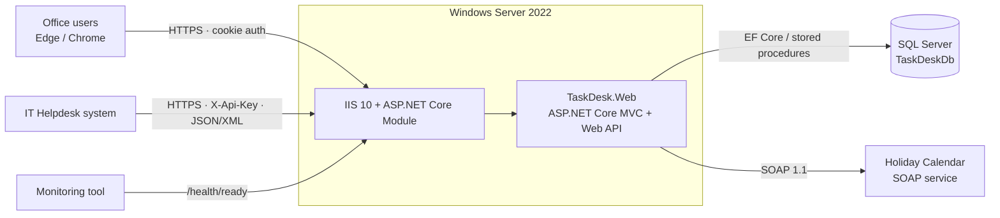
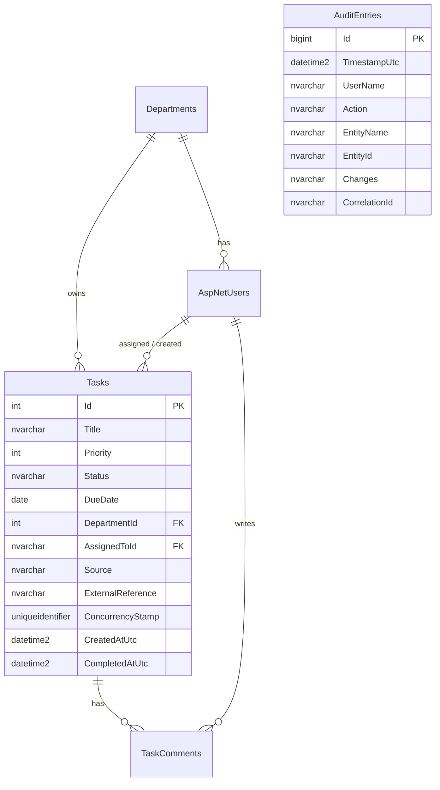
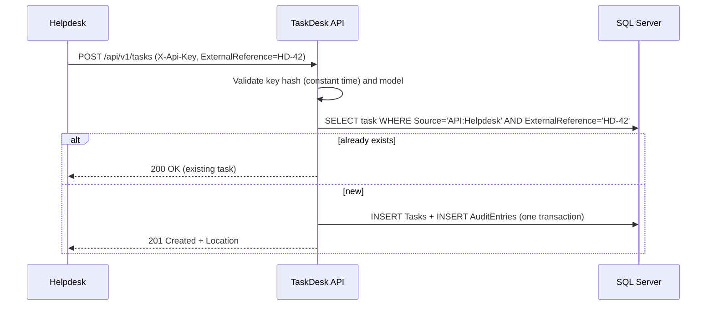

# TaskDesk – Technical Design

## Architecture

A single ASP.NET Core application keeps deployment simple for a small internal system, but the
code is layered by folder so responsibilities stay separate:

| Folder | Responsibility |
|---|---|
| `Domain` | Entities and business rules (`TaskItem` workflow, read-only when closed) |
| `Data` | EF Core `AppDbContext`, Fluent API mappings, automatic audit, database initializer |
| `Services` | Use cases with authorization rules (`TaskService`, `ReportService`, `AuditService`) |
| `Integration` | SOAP holiday client, API use cases (`IntegrationTaskService`), mock SOAP service |
| `Security` | API-key authentication handler, claims factory, policies |
| `Infrastructure` | Middleware (correlation ID, timing, security headers), error handling, health output |
| `Controllers`, `Views` | MVC UI; `Controllers/Api` is the REST API |

## Data model

**Indexes** follow the query patterns: `(AssignedToId, Status)` for "my tasks",
`(DepartmentId, Status, DueDate)` for team views and overdue reports, unique `(Source, ExternalReference)`
for API idempotency, `(EntityName, EntityId)` on `AuditEntries` for task history.

**Status** is stored as text for readability in SQL and reports; **Priority** is stored as a number so
`ORDER BY Priority` sorts correctly.

## Key design decisions
| Decision | Reason |
|---|---|
| ASP.NET Core Identity | Proven password hashing (PBKDF2), lockout, security stamp – no home-made crypto |
| Audit inside `SaveChanges` | Every change is captured automatically, in the same DB transaction, so developers cannot forget it |
| Optimistic concurrency (`ConcurrencyStamp`) | Two people editing the same task: the second save is rejected with a clear message instead of silently overwriting |
| Authorization in the service layer | Rules apply equally to every controller; users get 404 (not 403) for tasks they may not see, so existence is not leaked |
| API key stored as SHA-256 hash | A leaked config file does not reveal usable keys |
| Idempotent API create | Integration retries (timeouts, network errors) never create duplicate tasks |
| SOAP client degrades gracefully | A downstream outage removes holiday warnings but never blocks users |
| Stored procedure for workload report | Set-based aggregation in one round trip; DBAs can tune it without redeploying the app |
| Times stored in UTC, displayed in office time (UTC+05:30) | Unambiguous data; correct "today" for due dates |
| No JavaScript, strict CSP | Smaller attack surface; works on locked-down office PCs |

## Sequence – Helpdesk creates a task

## Error handling
- UI: unexpected errors show a friendly page with a **reference number** (correlation ID); details go to the log only.
- API: RFC 9457 `application/problem+json` – 400 validation, 401/403 auth, 404, 409 concurrency, 422 business rule, 500.

## Configuration
| Key | Purpose |
|---|---|
| `ConnectionStrings:TaskDesk` | SQL Server connection (set per environment, never committed) |
| `Database:Provider` | `SqlServer` (default) or `Sqlite` (local demo / tests) |
| `Office:UtcOffsetMinutes` | Office time zone, default 330 (Sri Lanka) |
| `Integration:HolidayService:Url` | SOAP endpoint; empty disables the integration |
| `Integration:Clients` | API clients: `Name`, `ApiKeySha256`, `Enabled` |
| `Monitoring:SlowRequestThresholdMs` | Log a warning above this duration (default 1000) |
| `Security:LoginAttemptsPerMinute` | Login rate limit per IP |
| `Seed:Enabled` / `Seed:DefaultPassword` | Demo data – development and UAT only |
